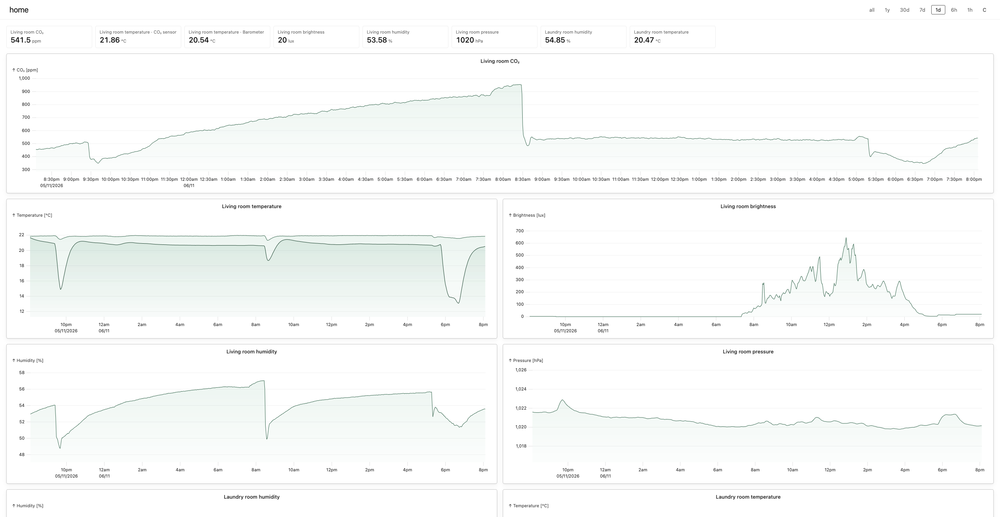
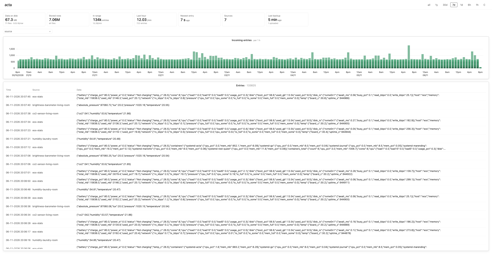
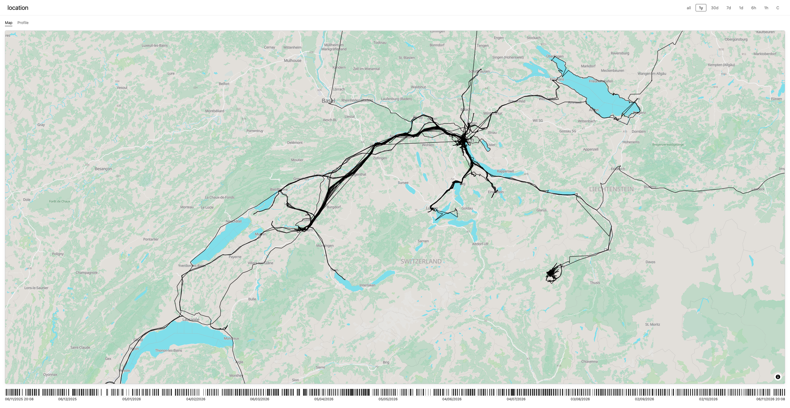
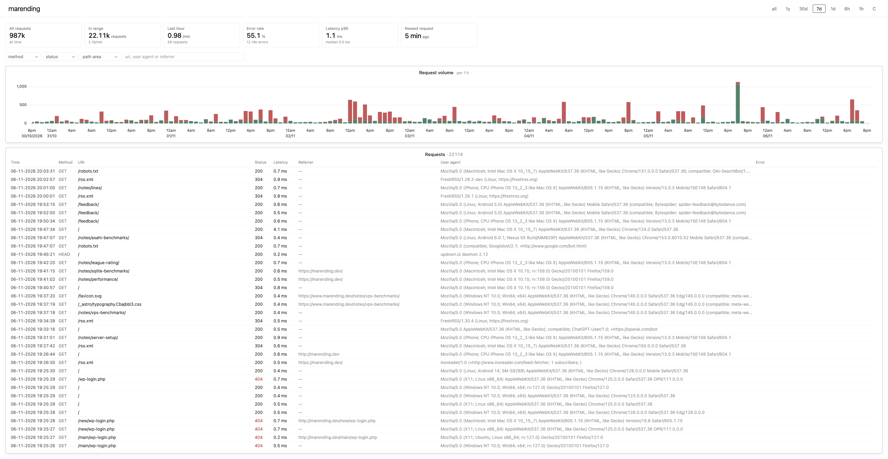
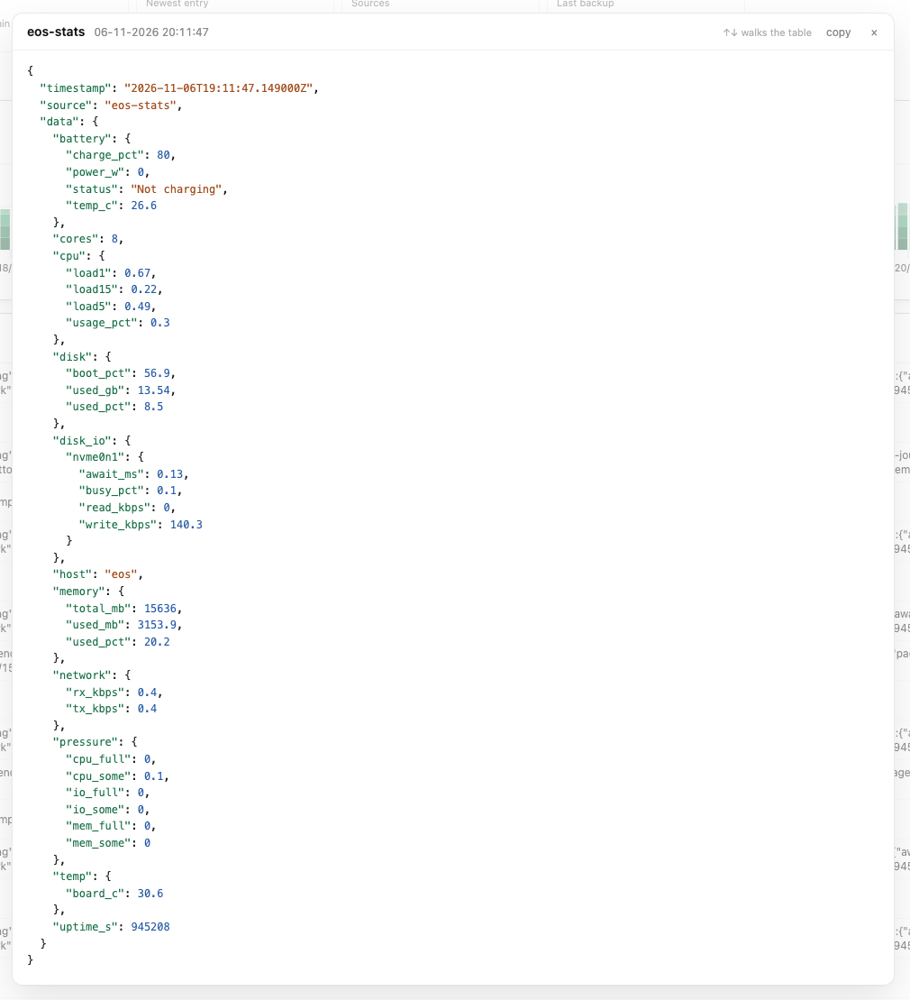
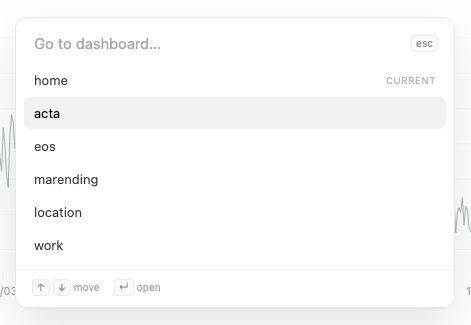

By my counting this will be the 10th note on this blog that touches on the topic of observability
and metric systems. I'm not going to recap everything, if you care about that go read
[this note](/notes/wide-events/). Just know this: I have home-made sensors around the house that
collect CO2, temperature, humidity etc., a GPS tracker app on my phone that records my location
regularly as well as backend services that emit wide-events to describe requests and other events
being handled. I want to collect this diverse data in an simple system that allows efficient
querying despite having no static schema. It turns out this is harder than it sounds.

So after years of pondering and experimenting, and a week or so of implementation, I happy to say
that [Acta](https://github.com/beingflo/acta) meets all my requirements. In the following sections I
want to outline how it works exactly, what it can do and what's the philosophy behind the approach.

## Features

There are two sides to Acta: The emitter side and the visualization side. Any device or service that
wants to send data to Acta has one unified API: Post a JSON object with a `source`, `timestamp` and
a `data` property. No custom tracing instrumentation or otherwise complicated plumbing, just send
arbitrary `data` and be done with it.

On the visualization side we can now query this data and build custom dashboards. Here's a selection
to illustrate what's possible:

`Home` This dashboard shows sensor data round the house. Every chart can be fullscreened with a
shortcut and is fully interactive with zooming / brushing.



`Acta` Sort of a self-introspection dashboard that is useful to look at the all the data in the
system. Filter by data source, watch new data stream in etc.



`Location` My GPS tracks visualized on a [self-hosted map](/notes/pmtiles). The gutter at the bottom
can be used to quickly hone in on a date-range of interest, a multitude of shortcuts are available
to zoom in on a bounding-box of visible tracks etc. Hovering a path segment indicates the date of
its recording in a tooltip.



`Marending` This dashboard queries the wide-events that the backend serving this website emits. I
can track how many page views I'm getting, which php vulnerability is currently popular with the
crawlers and much more.



For data tables, I have a bunch of niceities like highlighting the previously newest entry when the
data updates to quickly gauge how fast new data is streaming in. Clicking on a row opens a detail
view:



In general, the whole visualizing frontend is highly keyboard-driven, including a palette-like
dashboard selector.



Notably, there is no Grafana-like dashboard builder here. These dashboards are hardcoded. I realized
that especially with an LLM by your side, building a new dashboard and deploying the application is
just a matter of minutes. Maintaining a builder UI and giving it enough expressive power would be an
order of magnitude more effort for very little benefit. Natuarally, this makes Acta a highly
personal application. Anyone else wanting to use it could only use it as a base to fork away from.
But this is probably where such software is headed in the age of AI anyway.

## Implementation & Architecture

First I have to state the uncomfortable: Acta is entirely vibe-coded. I was planning to use this
project to test a spec-driven workflow, but I quickly found that discussing architecture with an LLM
and having it update the specs was a faster way of going about it than writing everything myself
from scratch. The workflow went something like this:

- Formulate desired target / feature / mechanism
- Challenge it with the LLM
- Have the LLM implement it
- Quickly glance over the shape of the code and steer it if I disagree
- Test it interactively
- Repeat

But as mentioned, I've been thinking about this space for years and had a very clear vision going
into this. Still, it was useful to challenge my assumptions and plans against an LLM. So ultimately
it took about a week of evenings and a Saturday to build Acta. I used DeepSeek v4.1 Flash 1017
exclusively, tallying about 8 dollars worth of tokens for the whole thing.

### Data storage

Choosing a simple data storage model has been a primary driver to for this whole undertaking. I
greatly enjoy the idea of separating data format from query engine. For this reason I went with
Apache Parquet here. Especially the `Variant` type is phenomenal in allowing me to combine the
flexibility of a schemaless payload with efficient storage and fast query performance.

So the way Acta stores data on disk is simple. The schema of an individual Parquet file look like
this:

```sql
timestamp  TIMESTAMPTZ  -- event time, or receive time
source     VARCHAR      -- e.g. 'co2-sensor-living-room'
data       VARIANT      -- arbitrary JSON payload
```

The service buffers data points it receives for 10 seconds, then writes them to a Parquet file.
Every 5 minutes, all small files are combined and written to a larger file. The same happens every
hour, day and month. So at any given time, there are a number of month files, at most 30 day files,
23 hour files, 11 5-minute files and 29 10-second files.

To run queries against this data I use glob imports in DuckDB to read from multiple files at once.
Parquet contains a metadata footer that includes min / max of every suitable column, this allows
DuckDB to skip reading entire files that are irrelevant to a given query.

On the read side, if there are no queries against the system, it just sits there idling. On the
write side, Acta writes small files regularily and compacts the smaller files into larger ones
spanning wider time ranges. The larger the files, the more compact the data gets for two reasons:
First, compression has a fixed overhead per file that gets more amortized in a larger file. Second,
DuckDB _shreds_ the `data` column into a binary representation when writing a file. The larger the
file (or rather row group), the more information is available to make good decisions here.

Ultimately, this leads to a very simple system. Instead of centering an application like this around
a particular database technology, it now builds on a standardized file format. One could imagine
switching out writer or reader without a fuss here. This sparks joy.

A small side note regarding the previous ClickHouse based system that Acta replaces: A straight
Parquet export of the OTel traces data set weighed in at 1.2 GB. After cleaning up the data (and
dropping some to be fair), the data had shrunk to a set of Parquet files of 65 MB. Have I mentioned
how much I like the `Variant` type yet?

### Auth

On the ingestion side, Acta accepts basic auth from sensors that want to publish data. The password
is just a fixed secret supplied to the service. For the visualization frontend, there are are
actually two sets of credentials, my own with complete access and one for my girlfriend to view the
`home` dashboard. I figured it was weird for her to be able to see my real-time location. So here,
Acta concatenates both passwords and uses that as a seed to dervice a signing key. When a user logs
in, the system uses the key to mint a new token and return it as a cookie. Later, the token can be
cryptographically verified to have been signed with the same key.

This way I don't need to maintain a stateful session store, at the cost of invalidating any session
when either of the credentials were to change (which would require a redeployment).

### API

To push data into the system there is an endpoint of this shape:

```http
POST /api/ingest
[{ "source": "co2-sensor-living-room", "timestamp": "2026-11-09T20:11:00Z", "data": { "co2": 812 } }]
→ 202 { "accepted": 1 }
```

`timestamp` is optional and defaults to the server's receive time. The GPS tracker app has its own
endpoint/ `POST /api/gps/{source}`, which takes a GeoJSON body and stores one row per GPS fix.

The visualization side started with a single endpoint that takes raw SQL:

```http
POST /api/data
{ "sql": "SELECT to_json(…)::VARCHAR FROM events WHERE …" }
```

However, after adding the second user that has restricted access to only the home sensor dashboard,
I needed a structured API that would only allow fetching those data series. For this reason there is
now an endpoint like this for just this data:

```http
POST /api/series
{ "metrics": ["co2_ppm", "living_temp_c"], "from": "…", "to": "…", "bucket_ms": 60000 }
→ [{ "t": 1762646400, "s0": 812.3, "s1": 21.4 }, …]
```

This way it's easy to restrict which series a user can ask for. It didn't fully migrate all API
usages to this, just the ones that were needed.

### Map

The Map on the `location` dashboard is integrated using `maplibre-gl`, the vector tiles are served
by the service itself using PMTiles. Read [this past note](/notes/pmtiles/) to learn more details.

To keep the size of the tile archive reasonable I didn't want to download the entire world in high
resolution. Instead, I opted to building a script which identifies locations that I've visited
(using an up-to-date Acta export) and pulls only those regions in high resolution. The rest of the
world is merged into the archive as a low-resolution basemap. The resulting ~200MB file is quite
decent in giving me good detail in places I've visited. The only problem is that it's always
backwards-looking, if I were on a longer vacation to a new place, I wouldn't see high resolution
there until I get back home and run a manual script.

Alas, this "dynamic resolution" thing is one of the things I would never have done if I had to build
that script myself, but with a clanker it's easy enough.

### Deployment

I don't want to get ahead of myself here, I'll write a more comprehensive note on my new hosting
setup. But to keep it short: The backend service serves the API, the frontend bundle and the PMTiles
archive. The service and the frontend are built into one container image, the tiles and the Parquet
data come in as mounts. That image runs under podman on an Asahi Linux box and is supervised by
systemd.

A deployment is handled via a script I run locally on my laptop. This builds the podman image and
then transfers it straight to the server, where it's installed and started.

For secrets management, I have a SOPS-encrypted file checked into the repo. On first installation,
another scripts first gets the decryption key out of 1Password programmatically, then installs the
secrets on the server in the form of podman secrets. Then the container declares it needs access to
them and sees them injected as environment variables.

### Backup

In previous systems, I would deploy side-car containers that regularly dump the database and upload
backups somewhere. Here, I went a different route. To simplify the deployment, the backup process is
built into the server process itself. A tokio task is spawned and scheduled to upload the latest
Parquet files to an S3 object storage once an hour. To ensure that the backup is running smoothly, I
also added a ping to my monitoring tool of choice [updown.io](/notes/monitoring/). Now if the backup
failed, say, due to expired S3 credentials, I would get alerted.

I chose this built-in mechanism over an external one to simplify operation. I think for
general-purpose application it makes sense to not include bells and whistels, but to let the user
plug together the components of their choosing. Since this is very explicitly designed for my
personal use, I may aswell build in my preferred way of backing up the data.

## Learnings

Acta is my first bigger application I built entirely using AI. Before I tried the spec-driven
workflow I figured it makes very little sense to have AI write specs and then also implement them,
after all, somewhere the human preference has to come in. But it quickly became clear that writing a
complete spec up front is tedious and also very "waterfally" in that you have to make up your mind
on a lot of topics before any work can begin.

I have found a planning phase where I discuss architecture with an LLM and it writes design docs to
work quite well. It's still important to instruct the LLM to keep the prose concise, after all you
don't want to just dump the full context of your discussions into files.

I belive the one thing I would do differently if this were a professional application would be to
invest a good amount of time into good test harnesses and make sure they are ultimately owned by a
human. That would be the way to encode the specs into executable tests that can pin correct
behaviour in place and allow rapid iteration. That would likely include a whole bunch of unit tests,
API tests (I do have a couple of hurl files in Acta), UI component tests as well as end-to-end
browser tests.
